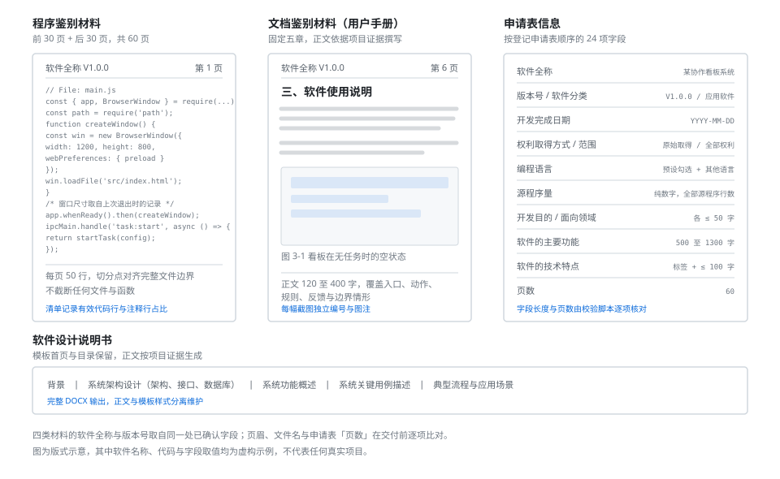
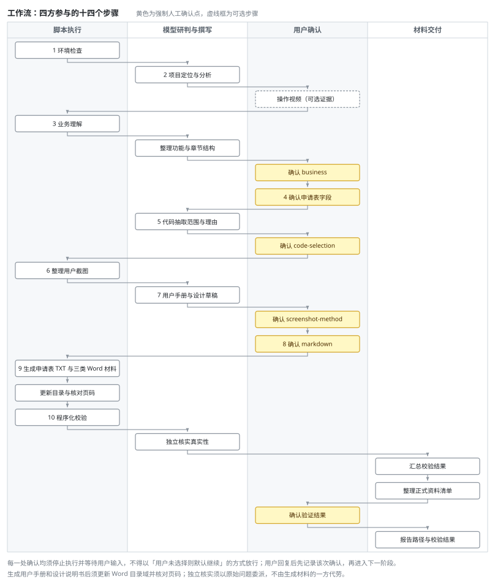

# software-copyright-materials

[](LICENSE)
[](#运行依赖)
[](SKILL.md)

从真实软件项目生成并校验中国计算机软件著作权登记材料。

材料由模型阅读项目后撰写，脚本只负责排版、校验与归档；流程设有分阶段人工确认，缺少必要输入时停止，而非按模板缺省生成。

> **适用**：计算机软件著作权（R11）的鉴别材料、申请表信息、用户手册与软件设计说明书。
> **不适用**：专利、商标，以及非软件类作品的著作权登记。

## 快速开始

**一、安装**——克隆到运行环境的 skill 目录，具体位置按该环境的 Skill 发现规则确定：

```bash
git clone https://github.com/likelikec/Software-copyright-writing-skill.git \
  <运行环境的 skill 目录>/software-copyright-materials
```

**二、触发**——在待登记的项目目录下，向助手说明：

```
用 software-copyright-materials 为当前项目生成软件著作权申请资料
```

提及「软著」「软著材料」「代码鉴别材料」「用户手册」「软件设计说明书」一类词亦可触发。

**三、应答**——流程在项目定位、业务口径、申请表字段、代码抽取范围、截图方式和草稿确认处等待输入。环境缺少 `python-docx` 时须先安装。Word 材料生成和验证完成后流程结束。

**四、产出**——全部材料生成于待登记项目的根目录下：

```
<项目根目录>/软件著作权申请资料/
├── 正式资料/            # 申请表 TXT、代码/用户手册/设计说明书 DOCX
├── 草稿/                # 业务理解、代码选择、申请表、用户手册、设计说明书与自检记录
│   └── 界面示意/        # 用户选择生成示意图时的 HTML 与截图方案
├── 截图/                # 用户手册真实截图或明确标注的界面示意图
├── 用户截图/            # 用户提供的原始截图，整理后进入上一目录
├── 操作视频/            # 视频帧，仅在提供录屏时生成
├── analysis/            # 项目分析的中间产物
├── 环境检查.md          # 与同名 .json，运行能力检查结果
├── 截图方式确认.json     # 截图方式的确认记录
└── 校验报告.md          # 交付前的程序化校验结果
```

正式资料与草稿分开存放：前者是经过确认和验证的交付材料，后者保存中间稿、证据和确认记录。

## 交付物

一次完整运行产出四类登记材料。



| 材料 | 内容与约束 |
| --- | --- |
| 程序鉴别材料 | 文件名为 `<软件全称>-<版本号>-源程序鉴别材料.docx`；源程序前 30 页与后 30 页合并为一份 Word；Courier New 六号字，长行按宽度换行。每页最多 50 个原始代码行，超出单页版心容量时停止生成；切分点对齐完整文件边界，不截断文件与函数 |
| 文档鉴别材料 | 五章用户手册 Word；第一页宋体一号居中封面，第二页为目录，正文由模型撰写，每幅插图带独立编号与图注 |
| 软件设计说明书 | 首页标题为“软件全称+软件说明书”（宋体一号），版本号为 Times New Roman 二号；第 3 章各功能小节依据真实实现详细说明职责、输入、处理、输出与边界 |
| 申请表信息 | TXT 格式，按登记申请表字段顺序列出 24 项字段；版本号统一为 V1.0.0，长度限制与页数由校验脚本逐项核对 |

申请表为 TXT，其余三类材料为 DOCX；版本号统一为 V1.0.0。封面、页眉和文件名在交付前逐项比对；申请表「页数」与代码 Word 的显式分页数比对。

公开仓库中的设计说明书模板只保留封面、目录样式和空白正文起点，不包含示例项目的设计正文；生成器会填入当前项目的软件名称与内容。

## 工作流

三方参与：脚本负责可机械执行的部分，模型负责研判与撰写，用户在各确认点作出决定。



每一处确认均须停止执行并等待用户输入，不得以「用户未选择则默认继续」的方式放行；用户回复后先记录该次确认，再进入下一阶段。

两处不可省略：其一，用户手册和设计说明书目录须更新并核对真实页码；其二，交付前的独立核实不能由生成材料的同一方代劳，须以原始问题委派，避免确认偏误。

完整的材料生成步骤、各步命令与材料规则见 [SKILL.md](SKILL.md)。

## 仓库结构

```
software-copyright-materials/
├── SKILL.md          # 材料生成、转换、验证工作流与核心原则
├── scripts/          # Python 脚本，负责证据整理、生成与验证
├── references/       # 8 份规则文档，按阶段读取
├── assets/           # 示意图与设计说明书 DOCX 模板
└── LICENSE
```

`references/` 按用途分为三类：材料规则（`copyright_material_rules.md`、`code_selection_rules.md`）、撰写规范（`business_understanding_rules.md`、`user_manual_structure.md`、`application_fields.md`）、归档与验收（`output_directory_rules.md`、`verification_checklist.md`）。另有一份 `worked_example_acticount.md` 提供正反例对照。

## 运行依赖

| 用途 | 依赖 | 缺失时 |
| --- | --- | --- |
| 全部脚本 | Python 3.10 或更高版本 | 无法运行 |
| Word 生成 | `python-docx` | 需安装后再生成四类材料 |
| 用户手册目录自动核页 | `soffice` 与 `pypdf` | 在 Word 中更新目录并核对页码 |
| 设计说明书目录更新 | Microsoft Word | 在 Word 中更新目录并核对页码 |
| 视频抽帧 | FFmpeg 与 FFprobe | 不处理视频；仍可使用项目或用户材料中的截图 |
| 真实截图整理 | 项目、用户截图或用户文档/PPT 中的可核实图片 | 无图时询问是否生成界面示意图或保留预留文字 |
| 界面示意图截图 | Chrome、Chromium 或 Edge | 仅在用户选择此方式时需要；生成简洁静态 HTML 后截图 |

申请表信息输出为 TXT，代码材料、用户手册和设计说明书输出为 DOCX。代码材料按原始代码行显式分页，长行在版心宽度内换行。安装 `pypdf` 且可调用 `soffice` 时，用户手册通过临时排版文件核准目录页码，临时文件不作为交付物；设计说明书目录在本机 Word 可用时更新。

## 设计取向

**只采用真实项目中的内容。** 代码逐行取自源文件，不作补齐与改写；业务理解须能回溯到源码或项目文档；申请表的叙述性字段不足字数下限时保留原文并要求补写，不以生成的通用描述替换。缺少必要输入即停止。另须注意，项目自述与实现不符属常见情形，凡涉及数值口径、数据流向、状态判定、操作步数与控件文案，一律回到源码核对，不照抄 README。

**章节结构固定且可核查。** 用户手册固定为五章；设计说明书固定包含背景、系统架构设计、系统功能概述、系统关键用例描述和典型流程与应用场景。脚本只负责排序、排版和校验，正文由模型依据项目证据撰写。

**正文由模型撰写，脚本不拼装句子。** 此项为对常见做法的纠正。按结构化字段拼装句子实现简便，产出的却是模板化正文与偶发病句，此类文字在审阅时容易辨识。本项目的处理方式为：脚本仅负责章节编号、图注、表格、页眉与各项校验，发现问题一律报为待修正项交由模型重写，不代笔、不润色。

**排版与行文以审核人员为准。** 功能章节使用日常语言，技术表述集中于设计说明书；截图独立编号与图注；代码切分对齐完整文件边界，不在函数中间截断；提取清单记录每个文件的交付行号与页码，便于抽查；四类材料的名称、版本、页眉与页数在交付前逐项比对。

## 常见问题

**代码材料中的注释是否需要删除？**
不删除。注释是源程序的组成部分，删除会使材料的行号不再与源码对应，抽查时无法逐行回溯。抽取环节会统计有效代码行占比，低于 60% 时给出提示，此时应改选注释密度较低的核心源码或增补文件，而非删除注释。

**为何须满 60 页？**
《计算机软件著作权登记办法》第十条要求源程序由前、后各连续 30 页组成，不足 60 页时生成全部。抽取环节会自动重排已选文件的顺序以精确对齐；确实无法对齐时，偏差超出阈值即停止并要求调整抽取范围，阈值内则以真实页数命名文件，不会出现文件名写「前30页+后30页」而实际只有 59 页的情形。

**用户手册目录页码如何更新？**
用户手册第二页是 Word 目录域。安装 `pypdf` 且可调用 `soffice` 时，生成器会按实际排版更新目录缓存页码；其他环境须在 Word 中更新目录并核对页码。

**设计说明书的目录页码如何更新？**
生成器保留样例模板的目录格式，并根据新正文重建目录项。在 macOS 且 Word 可用时，它会重新分页、更新目录页码并保存 DOCX；其他环境下保留打开文档时更新域的设置，交付前须在 Word 中更新目录并核对页码。

**用户手册可否依据项目 README 撰写？**
不可。项目自述与实现不符是常态。一次核实中查出八处失实，其中一条称统计数值不外发、而实际请求携带了这些数值——这属于隐私声明失实。涉及数值口径、数据流向、状态判定、操作步数与控件文案的表述，一律以源码为准。

**没有可用截图时如何处理？**
先查项目、用户截图及提供的文档/PPT。仍无可用图时询问用户：生成基于真实功能证据的简单界面示意图，或保留截图预留文字。示意图的图注标明“界面示意，非实际运行截图”；保存 HTML、截图与证据清单供核对。

## 版本

当前版本为 5.2.0。

自 5.2.0 起，申请表信息输出为 TXT，版本号固定为 V1.0.0；设计说明书封面和第 3 章写作规则按本次要求更新。

自 5.1.0 起，代码材料使用 Courier New 六号字；用户手册采用宋体一号居中封面、第二页目录和固定五章结构。

自 5.3.0 起，缺少真实截图时可由用户选择生成简洁界面示意图；设计说明书第 3 章功能小节按职责、输入、处理、输出和边界展开。申请表不包含软件简称字段，正式资料含软件设计说明书 DOCX。

旧版本中的 PDF 生成路径已移除；本版运行时不会创建这些文件。

## 来源与许可

本仓库基于 [suling-fun/software-copyright-materials-skill](https://github.com/suling-fun/software-copyright-materials-skill) 的工作继续修改；该项目源自 [Fokkyp/SoftwareCopyright-Skill](https://github.com/Fokkyp/SoftwareCopyright-Skill) 1.3。当前仓库由 [likelikec](https://github.com/likelikec) 维护，保留原有版权与许可声明。主要变化如下：

- 建立正式资料、中间产物、截图和视频帧的固定归档目录。
- 将操作视频处理能力精简为 FFmpeg 与 FFprobe 抽帧，移除语音转录依赖。
- 增加分阶段用户确认、材料一致性检查与交付前校验机制。
- 重构项目分析、代码材料、申请信息、用户手册与 DOCX 生成脚本及相应规则。
- 代码材料的前后两段自动重排文件顺序以精确对齐 30+30 页，并统计有效代码行与注释行占比。
- 增加用户手册和设计说明书的目录更新，以及四类材料的一致性校验。

本项目继续采用上游的 MIT License，并完整保留原版权与许可声明，详见 [LICENSE](LICENSE)。使用本项目不代表获得任何机构的认可、认证或背书。

## 免责声明

本项目仅提供材料整理与校验辅助，不构成法律意见或登记结果保证。使用前应由申请人核对材料、权属和适用规范。生成材料的适用性仍须由申请人结合实际要求判断。
